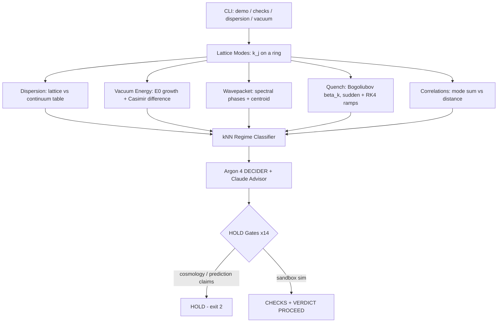
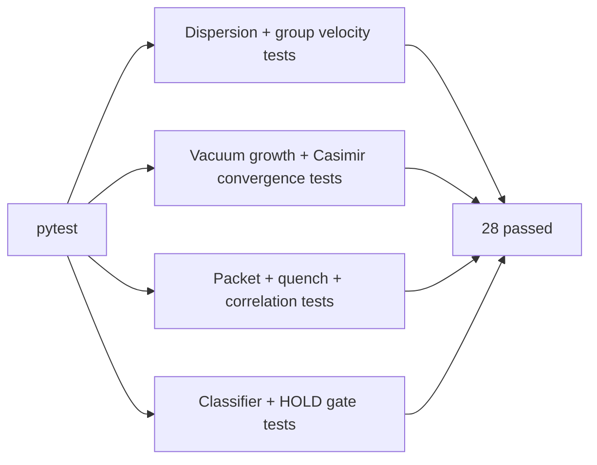
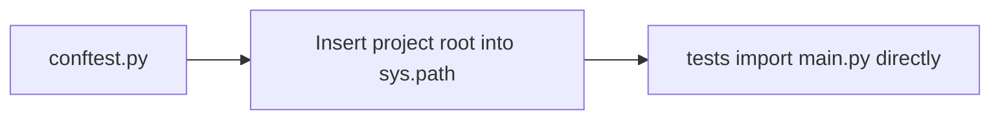
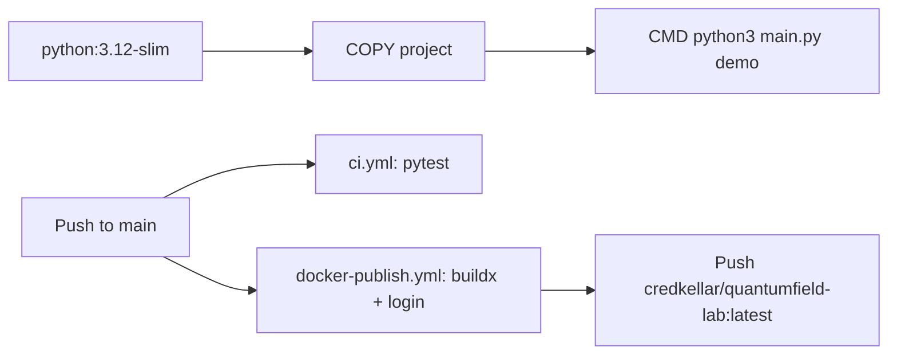

# QuantumField-Lab 🌌⚛️

**Quantum Field Theory on a Lattice Lab** — by Darion Kellar

QuantumField-Lab is an **educational quantum field theory lab** in ONE pure-Python file. It quantises the simplest field there is — a **free scalar (Klein-Gordon) field** — on a finite 1D lattice of coupled oscillators, in natural units ħ = c = 1, and computes everything exactly from the lattice mode sum: the dispersion relation, the vacuum energy, a moving wavepacket, particle creation by a mass quench (Bogoliubov coefficients), and the vacuum two-point correlation. 🔬

The lattice is a **regulator**, and this lab's whole point is to show the seam it leaves:

- **Continuum field** = ω = √(m² + k²), vacuum energy subtracted away by fiat, packets that ride at k/ω. 📐
- **Lattice field** = ω = √(m² + (4/a²)·sin²(ka/2)): the dispersion bends **35.19% low at the zone edge**, the packet rides **6.27% slower** than the continuum predicts, and the vacuum energy **explodes ×49.02** as the lattice refines — while the subtracted Casimir difference between two boundary conditions quietly **converges** to a stable number, and for a massless field lands on the exact continuum value −π/(4L). 🧮

Honest scope, stated up front: every parameter is a **labelled teaching value** — no spacetime was quantised, no particle was created anywhere but in the arithmetic, and no number here is a prediction about the real universe. Every cosmology / particle-physics / vacuum-energy claim sits behind a permanent HOLD gate (14 total). 🔒

[](https://github.com/kimanicollier44-cmyk/QuantumField-Lab/actions/workflows/ci.yml)
[](https://github.com/kimanicollier44-cmyk/QuantumField-Lab/actions/workflows/docker-publish.yml)

> ℹ️ These are the **live** workflow badges for this repo. They activate as soon as the `ci.yml` and `docker-publish.yml` files from the paste pack are pasted into `.github/workflows/` — until then they have nothing to report yet.

## 🧰 Tech Stack Badges & Full Architecture Tech Stack

### 💻 Core Programming Languages & Core Systems


- 🐍 Python 3.12, pure standard library (`math`, `hashlib`, `json`, `sys`) — zero dependencies, zero network, deterministic (double-run byte-identical)
- 🌊 Field core: the lattice dispersion `ω_k = √(m² + (4/a²)·sin²(ka/2))` from the discrete Laplacian, exact mode sums for the vacuum energy `E0 = ½Σω_k` and the correlation `⟨φ_x φ_0⟩ = (1/N)Σ cos(kx)/(2ω_k)` — every headline number asserted against an analytic value or an independent route in CHECKS
- 🎛️ Dynamics: spectral-phase wavepacket evolution with a circular intensity centroid, and per-mode RK4 integration of `q̈ + ω_k(t)²q = 0` for smooth mass ramps, with the Bogoliubov coefficient read off the mode function exactly
- 🧠 TinyML kNN regime classifier (from scratch, stdlib): continuum-like / lattice-artefact / quench-violent / quench-adiabatic from dispersion deviation + quench production + velocity error
- 🪑 Council seats: Gemini Argon 4 DECIDER (names-only, tighten-only) + Muse advisor (never overrides HOLD) + Google Flow plan-only (rendered = False, live = 0)

### ⛓️ Web3 & Infrastructure

- 🚫 **Not applicable — honestly.** No blockchain, no Web3, no tokens: the "infrastructure" in this lab is a ring of coupled oscillators and a mode sum inside one offline file. No fake badges here.

### ⚙️ Platform Support & Hardware Architecture


- 🖥️ Pure Python — runs anywhere Python 3.12+ runs (Linux, macOS, Windows), plus the `python:3.12-slim` Docker image
- 🔒 No hardware is controlled, ever: real detectors, colliders, and telescopes are permanent HOLD gates (see the gate table below)

### ⚡ Low-Level Infrastructure & Performance

- 🚫 **No low-level code — honestly.** No C, no C++, no GPU, no compiled extensions: this is one interpreted Python file on purpose, so every mode frequency can be read, checked, and diffed. Performance here means honest algorithms — closed-form mode sums instead of time evolution where the answer is a sum, a fixed-step RK4 only where the ramp makes it necessary — all deterministic and byte-identical between runs.

### 🛠️ DevOps & Build Tools


- 🐳 Docker (`python:3.12-slim`), GitHub Actions CI + Docker Publish (delivered in the paste pack)
- 🎯 Target image: `credkellar/quantumfield-lab:latest`
- 🧪 Tests: `pytest` (28 tests) + the built-in CHECKS suite (45 checks) in `main.py`

### ☁️ Cloud Providers

- 🚫 **None — honestly.** No cloud provider is used or needed: the lab runs fully offline on your own machine or in a local Docker container. Docker Hub appears only as the registry the publish workflow pushes the image to.

## What this does?

1. 🌊 **Dispersion — the seam, measured** — on the demo lattice (N = 64, a = 1, m = 0.5) the lattice frequency tracks √(m² + k²) at small k (deviation 0.000015 at k = 0.098) and then bends away: 0.8786% low at the packet's k₀ = 0.6, 9.01% low at k = π/2, and **35.19% low at the zone edge** (ω = 2.061553 vs the continuum's 3.181133). The full eight-row table is computed, not quoted.
2. 📦 **Vacuum energy, volume growth** — E0 = ½Σω_k at fixed spacing a = 1: 11.2227 → 22.4454 → 44.8907 → 89.7815 as N doubles 16 → 128, with E0/N pinned at **0.701418** — doubling the box doubles the vacuum energy exactly. That part is just volume.
3. 💥 **Vacuum energy, cutoff growth** — at fixed volume L = 64, refining the lattice (a = 2 → 0.25) sends E0 from 13.4209 to **657.8284 — a ×49.0153 explosion**. The sum is dominated by the highest modes the lattice can hold: this is the divergence, shown with the lid off instead of subtracted away in silence.
4. ⚖️ **The finite difference (Casimir)** — subtract the antiperiodic vacuum from the periodic one at the same lattice (L = 8, m = 0.5) and the explosion cancels: the difference settles at **−0.003974**, with the change per refinement shrinking 5.15e-05 → 1.29e-05 → 3.21e-06 → 8.03e-07. For a massless field the same lattice difference at N = 128 gives −0.098176 against the exact continuum value **−π/(4L) = −0.098175**.
5. 🔀 **Mass subtraction, honestly labelled** — at one fixed lattice (N = 64, a = 1), E0(m = 0.5) − E0(m = 1.5) = **−20.113232**: a finite number you can compute, printed as what it is — a difference at a stated cutoff, not a measured vacuum energy.
6. 🏃 **Wavepacket — one packet, three predicted speeds** — a Gaussian packet (k₀ = 0.6, σ_k = 0.10, N = 128) rides from x = 64.0 to x = 92.8. Its measured centroid velocity is **0.720064**: it matches the |c_k|²-weighted lattice group velocity 0.720184 to **0.017%**, sits 1.27% below dω/dk at k₀ (0.729358 — the finite packet width, explained in the code), and a full **6.27% below the continuum prediction** 0.768221. The lattice is measurably slower, and the lab says by how much.
7. ⚡ **Sudden quench — particle creation, counted** — jump the mass m = 0.5 → 1.5 at t = 0 and every mode produces particles: |β_k|² = (ω_out − ω_in)²/(4ω_inω_out), peaking at exactly **1/3** for the zero mode, with |α_k|² − |β_k|² = 1 asserted mode by mode. Total created: **4.722298** particles across the 64 modes — in the arithmetic, nowhere else.
8. 🐢 **Smooth ramps — the adiabatic discount** — the same mass change stretched over a smoothstep ramp, integrated mode by mode with RK4: τ = 1 creates 3.446598, τ = 5 creates **0.315786 — a ×14.9541 suppression** against the sudden jump. A near-sudden numeric ramp (τ = 0.05) reproduces the analytic sudden total inside 2%, so the integrator and the formula grade each other.
9. 🔗 **Vacuum correlations — mass is a range limit** — ⟨φ_x φ_0⟩ from the mode sum (N = 128): the massive field falls 0.436998 → 0.001816 by separation 8 (C(8)/C(0) = **0.004156**), while the massless field (zero mode omitted — a labelled infrared regulator) still holds 0.149683 of its 0.792218 (ratio **0.188942**, ~45× farther reach). Same sum, same lattice; the mass is the difference.
10. 🏷️ **Regime classifier + seats + checks** — a from-scratch kNN labels scenarios continuum-like / lattice-artefact / quench-violent / quench-adiabatic from (dispersion deviation, quench production, velocity error): the sudden demo quench is quench-violent, a coarse a = 2 lattice is a lattice-artefact, the τ = 5 ramp is quench-adiabatic, and a fine unquenched lattice is continuum-like — with Argon 4 DECIDER (sha256 trace), Muse advisor, Google Flow plan-only, and a built-in CHECKS suite (45 checks).

## 🗺️ How it works — diagram per script

### `main.py` — the whole lab



### `tests/test_main.py` — verification



### `conftest.py` — test path setup



### `Dockerfile` + CI flow — container & publish



## Why is this cool?

1. 🌊 The dispersion seam is **measured, not mentioned**: one table shows the lattice frequency peeling away from √(m² + k²) until it is 35.19% low at the zone edge — the exact place where every lattice field theory quietly stops being the continuum.
2. 💥 The vacuum-energy divergence is shown **with the lid off**: ×49.0153 growth under refinement, printed in a table, instead of the usual silent subtraction.
3. ⚖️ And then the Casimir difference **converges anyway** — the change per refinement falls below 1e-6 while E0 explodes past 5,000 on the same study's finer box, and the massless case lands on −π/(4L) to five decimal places.
4. 🏃 The packet **grades three predictions at once**: measured speed vs the weighted lattice velocity (0.017%), vs dω/dk at the centre (1.27%, explained by the packet's own width), vs the continuum (6.27% — the artefact, priced).
5. ⚡ Particle creation is **counted mode by mode**: |β_k|² peaks at exactly 1/3, unitarity |α|² − |β|² = 1 is asserted for every mode, and the total 4.722298 is a sum you can audit line by line.
6. 🐢 The adiabatic discount is **integrated, not asserted**: RK4 mode evolution shows a τ = 5 ramp creating ×14.9541 fewer particles than the jump — and a near-sudden ramp reproduces the analytic jump, so the numerics grade the formula.
7. 🔗 Correlations make mass **visible as a range limit**: same lattice, same sum — the massive field is dead by separation 8 (ratio 0.004156), the massless one still holds 0.188942.
8. 🎛️ Natural units and labelled parameters throughout: ħ = c = 1 stated, every mass / spacing / ramp time named as the teaching choice it is.
9. 🔒 The honesty is load-bearing: 14 HOLD gates refuse every cosmology, particle-physics, and vacuum-energy claim this toy could be dressed up as.
10. 🎯 Deterministic end to end: run it twice, get byte-identical output — a quantum field you can diff.

## What problems this solves?

1. ❌ **Problem:** QFT teaching jumps from "fields are oscillators" to Feynman diagrams with nothing computable in between. ✅ **Solution:** A free field you can actually finish: modes, energies, packets, quenches, and correlations, each an exact sum in one file.
2. ❌ **Problem:** The lattice-vs-continuum difference is usually a footnote ("discretisation errors exist"). ✅ **Solution:** It is a measured table with a headline number — 35.19% at the zone edge, 0.88% already at a working momentum.
3. ❌ **Problem:** Vacuum energy is presented as either zero (subtracted) or 10^120 (the famous mismatch), never as a computation. ✅ **Solution:** Both growth laws are computed (volume ×2 exact, cutoff ×49.0153), and the finite subtracted difference is shown converging on the same page.
4. ❌ **Problem:** "Particles are created when the universe expands" is asserted with no mechanism a student can run. ✅ **Solution:** The Bogoliubov mechanism runs here in miniature: a mass quench, per-mode |β_k|², a unitarity check, and a total.
5. ❌ **Problem:** Adiabaticity is a slogan ("slow changes create nothing"). ✅ **Solution:** It is priced: τ = 1 vs τ = 5 vs sudden, integrated mode by mode — ×14.9541 suppression, with the integrator cross-checked against the sudden formula.
6. ❌ **Problem:** Group velocity is taught as dω/dk at a point, as if packets were points. ✅ **Solution:** The packet's measured speed is compared against the point value, the width-weighted value, and the continuum value — and the three disagreements are each explained.
7. ❌ **Problem:** Correlation length is an abstraction until it isn't. ✅ **Solution:** ⟨φ_x φ_0⟩ is tabulated for massive and massless fields on the same lattice; the mass cuts the reach by a factor of ~45 at separation 8.
8. ❌ **Problem:** Simulation tools quietly imply physical prediction. ✅ **Solution:** `cosmology_claim`, `particle_physics_prediction`, and `vacuum_energy_cosmology_claim` are permanent HOLD gates returning exit code 2, forever.
9. ❌ **Problem:** Regulator dependence (cutoff, boundary conditions) is hidden inside software defaults. ✅ **Solution:** Boundary conditions are an explicit switch here, and the Casimir study is precisely the statement of what does and does not depend on them.
10. ❌ **Problem:** Toy models borrow the vocabulary of real QFT (vacuum, particles, creation) without earning it. ✅ **Solution:** Every borrowed word is defined by the sum that computes it, and the honest-scope paragraph travels with every report.

## How to install this?

1. 📋 Clone or download this project folder.
2. 🐍 Make sure Python 3.12+ is installed: `python3 --version`
3. ▶️ Run the full demo + checks (no arguments needed):

```bash
python3 main.py
```

4. 🧪 Run the test suite:

```bash
pip install pytest
python3 -m pytest -q
```

5. 🎛️ Try the other commands:

```bash
python3 main.py checks      # 45 built-in checks
python3 main.py dispersion  # lattice vs continuum frequency table (JSON)
python3 main.py vacuum      # E0 growth + Casimir convergence report (JSON)
python3 main.py packet      # wavepacket velocity vs three predictions (JSON)
python3 main.py quench      # sudden vs smooth quench production (JSON)
python3 main.py correlate   # massive vs massless correlations (JSON)
python3 main.py classify    # kNN regime classifier report
python3 main.py brains      # Argon 4 + Muse + Flow seats
python3 main.py holds       # list all 14 HOLD gates
python3 main.py hold-demo   # exits 2 - gated actions stay HOLD
```

6. 🐳 Or run it in Docker:

```bash
docker build -t credkellar/quantumfield-lab:latest .
docker run --rm credkellar/quantumfield-lab:latest
```

## Requirements

- 🐍 Python 3.12 or newer
- 📦 Dependencies: **none** (standard library only)
- 🌐 Network: **none** — fully offline
- 🧪 For tests only: `pytest`
- 🐳 Optional: Docker

## FULL project structure tree

```text
quantumfield-lab/
├── main.py                  # the whole lab: lattice modes, dispersion, vacuum energy, Casimir difference, wavepacket, Bogoliubov quench, correlations, classifier, seats, HOLD gates
├── conftest.py              # puts the project root on sys.path for tests
├── tests/
│   └── test_main.py         # 28 pytest tests: dispersion, vacuum, Casimir, packet, quench, correlations, gates, determinism
├── assets/
│   └── cover.png            # README cover image (2736 x 912)
├── Dockerfile               # python:3.12-slim, runs the demo
├── .gitignore               # __pycache__/, .pytest_cache/, *.pyc
└── README.md                # this file
```

> 📦 Delivered separately as paste packs (not in this tree): `.github/workflows/ci.yml` + `docker-publish.yml`, and the Docker Hub pack (100-char description, 350-char About, overview, categories).

## 🔒 HOLD gates — all 14, permanent

| # | Gate | What stays held |
|---|------|-----------------|
| 1 | `cosmology_claim` | No claims about the real universe's expansion, inflation, or reheating |
| 2 | `particle_physics_prediction` | No predicting real particle masses, couplings, or collider outcomes |
| 3 | `real_particle_creation_claim` | No claim particles were created anywhere but in the arithmetic |
| 4 | `quantum_gravity_claim` | No quantum-gravity claims; the lattice is a regulator, not spacetime |
| 5 | `vacuum_energy_cosmology_claim` | No cosmological-constant / dark-energy claims from a lattice sum |
| 6 | `casimir_device_claim` | No real Casimir-force device or measurement claims |
| 7 | `faster_than_light_claim` | Lattice dispersion artefacts never license superluminal claims |
| 8 | `free_energy_claim` | Vacuum energy is not extractable energy; no free-energy devices |
| 9 | `hawking_radiation_claim` | No black-hole evaporation claims from a mass-quench toy |
| 10 | `unruh_effect_claim` | No accelerated-detector radiation claims from this lab |
| 11 | `standard_model_claim` | One free scalar toy is not the Standard Model |
| 12 | `simulation_as_experiment_claim` | Simulation output is not experimental data |
| 13 | `weaponisation_claim` | No weapons relevance claims of any kind |
| 14 | `investment_claim` | No investment claims; a lab model is not a prospectus |

🧑‍⚖️ **Council seats:** Gemini Argon 4 Extended Thinking — DECIDER (names-only, tighten-only, MAP → MODEL → STRESS → DECIDE, sha256 trace, `can_override_hold = False`) · Muse — advisor (`can_override_hold = False`) · Google Flow — plan-only (`rendered = False`, `live = 0`).

✅ **Verification:** pytest **28 passed** (project + clean copy) · built-in CHECKS **45/45** · double-run output **byte-identical** · `hold-demo` exits **2** · `main.py` **892 lines**, pure stdlib, zero network.

## 🧒 5th-grade English section

Imagine space is not smooth like a tabletop, but more like a **bed made of tiny springs**, all connected to each other in a row. 🔗

- Wiggle one spring and a wave runs along the bed. This lab builds that spring bed inside a computer and lets the waves run — and the waves on the spring bed travel a little **slower** than waves in perfect smooth space. The lab measures exactly how much slower (about 6% for its test wave). 🐢
- Even when nobody wiggles anything, the springs are never perfectly still — they always hum with a tiny bit of energy. If you make the springs smaller and closer together, the humming gets **louder and louder**, faster than you can count. But if you compare two beds that differ only in how their ends are tied, the *difference* in humming stays calm and steady. That steady difference has a name: the **Casimir** effect. ⚖️
- Now shake the whole bed. Shake it **suddenly** and ripples pop up everywhere — the lab counts them and calls them "particles" (4.72 of them, in math only). Shake it **slowly and gently** instead, and almost no ripples appear (only 0.32). Slow shakes are kind shakes. 🐢
- Neighbouring springs like to move together. For a **heavy** field, that togetherness dies out after just a few springs. For a **light** field, springs far apart still move together — like friends holding hands across a long line. 🤝
- This project is a **pretend lab on a computer**. It does not describe the real universe, does not create real particles, and does not predict anything. It helps you learn how a field — the thing real physics is built from — behaves when you can count every piece of it. 💻

---

MIT © 2026 Darion Kellar · QuantumField-Lab — educational simulation only 🌌
